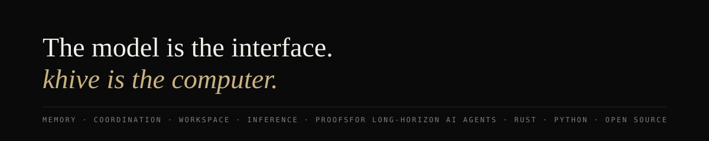
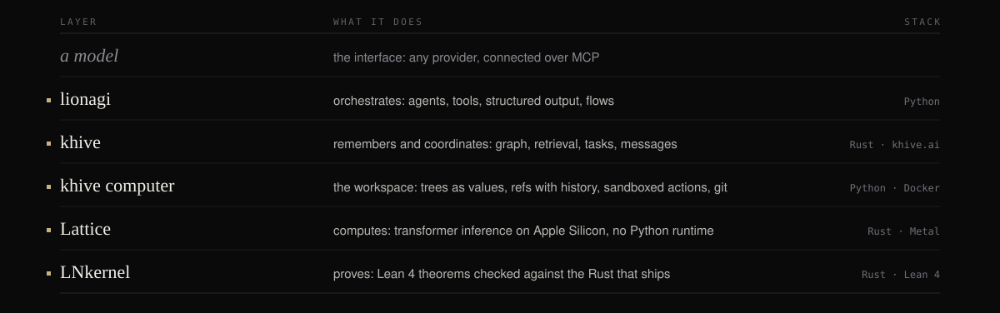

  

# Haiyang (Ocean) Li

**TL;DR.** Founder of [khive AI](https://khive.ai), New York. I build the infrastructure long-horizon AI
agents run on: a system of record and operations for agent organizations ([khive](https://github.com/ohdearquant/khive)),
an orchestration framework ([lionagi](https://github.com/ohdearquant/lionagi)), a workspace for AI agents
([khive computer](https://github.com/ohdearquant/khive-computer)), a pure Rust inference engine for Apple Silicon
([Lattice](https://github.com/ohdearquant/lattice)) and a formally verified agent kernel
([LNkernel](https://github.com/ohdearquant/LNkernel)). Rust and Python, open source, built in public.

  
  
  
  

  
  
  
  
  

The commit activity here is real: my repositories are built around the clock by the agent fleet they serve.
I design the architecture, set the constraints and gate the merges; the agents do the rest. Every rough edge
my agents hit is one your agents would have hit too, so each product is the residue of running the thing at
full intensity.

Co-founder, [Agentics Foundation](https://agentics.org) · co-maintainer, [AG2](https://github.com/ag2ai/ag2) ·
[Lion Saturday](https://github.com/ohdearquant/Live-Streaming) live streams

## The stack

  

| Project | What it is | Stack · get it |
| --- | --- | --- |
| [khive](https://github.com/ohdearquant/khive) | The system of record and operations for agent-native organizations, served over MCP: entity graph with typed edges, hybrid retrieval (HNSW, BM25, rank fusion, in process), durable task state, memory with salience and decay, inter-agent messaging. Hosted at [khive.ai](https://khive.ai); self-hosted from one binary and SQLite. | Rust · 50+ crates on [crates.io](https://crates.io/search?q=khive) · [docs](https://ohdearquant.github.io/khive/) |
| [lionagi](https://github.com/ohdearquant/lionagi) | Agent orchestration, built continuously since 2023: model-agnostic tool use, structured output, multi-agent flows, typed operations, the runtime my own fleet runs on. | Python · `pip install lionagi` |
| [khive computer](https://github.com/ohdearquant/khive-computer) | Workspace for AI agents, over MCP. Files live in content-addressed trees and a write returns a new tree; refs move by compare-and-swap with history; commands run on a tree in a sandbox and come back as a tree, cached by their inputs; git at the edge; one token is one seat. Eight tools. | Python · `uv tool install khive-computer` · `kc up` runs it in Docker |
| [Lattice](https://github.com/ohdearquant/lattice) | Transformer inference in pure Rust on Apple Silicon: Qwen 3+ and Gemma 4 including vision-language and vision embedding, Metal and CPU, quantization and LoRA fine-tuning, a native macOS app. No Python, no CUDA, no ONNX; about 5% of ONNX Runtime's binary size. Serves embeddings on a Raspberry Pi. | Rust · Metal |
| [LNkernel](https://github.com/ohdearquant/LNkernel) | A formally verified agentic kernel: Lean 4 proofs of the kernel data structures, the capability algebra and the policy rules, machine-checked against the Rust definitions. | Rust · Lean 4 |

### Also public

| Project | What it is |
| --- | --- |
| [moodboard](https://github.com/ohdearquant/moodboard) | Visual coherence measurement: how well an image fits a board's look, with calibrated intervals and a traceable offline report |
| [CanonSys](https://github.com/ohdearquant/canonsys) | Agent governance: a policy DSL, a charter runtime and a cryptographic evidence chain |
| [medgraph](https://github.com/ohdearquant/medgraph) | ICD-10-CM read as the graph it already is, packed for khive, with a one-command demo |
| [lionag2](https://github.com/ohdearquant/lionag2) | lionagi primitives on AG2: multi-player, multi-threaded agent orchestration |
| [lean-proofs](https://github.com/ohdearquant/lean-proofs) | Formal proofs in Lean 4 |
| Quant notes | [American put optimization](American%20Put%20Optimization.md) · [SPX option intraday backtest](SPX%20option%20intraday%20backtest.md) |

## Choose your entry point

| I want to… | Start here | Then |
| --- | --- | --- |
| Give my agents a system of record: memory, tasks, messages, a graph | [khive.ai](https://khive.ai) or [self-host khive](https://github.com/ohdearquant/khive) | connect any MCP client to it |
| Give an agent a place to work: trees, refs, sandboxed commands, git | [khive computer](https://github.com/ohdearquant/khive-computer) | `kc up` and hand the client the token |
| Orchestrate agents in Python with structured output | [lionagi](https://github.com/ohdearquant/lionagi) | run them against a khive and a computer |
| Run Qwen or Gemma on a Mac with no Python runtime | [Lattice](https://github.com/ohdearquant/lattice) | embeddings, reranking and classification in process |
| Read machine-checked proofs about an agent kernel | [LNkernel](https://github.com/ohdearquant/LNkernel) | the Lean 4 side of the Rust |

## Depth

- **Retrieval**: HNSW, BM25 and reciprocal rank fusion in process, SIMD-accelerated similarity, no external vector database.
- **Inference**: the transformer forward pass from scratch, LoRA injection, 4-bit quantization with rotations (QuaRot).
- **Memory for agents**: salience-weighted recall, decay, provenance, retrieval trained on the agents' own feedback.
- **Workspaces for agents**: content-addressed trees, compare-and-swap refs, cached sandboxed actions, git kept at the edge.
- **Formal methods**: Lean 4 proofs extracted from the Rust that ships.

## Reach, with dates

Public GitHub API snapshot, **October 14, 2026**. Owned repositories, forks excluded.

| Measure | Value |
| --- | ---: |
| Followers | 189 |
| Public repositories | 16, of which 12 owned and not forks |
| Stars across owned public non-fork repositories | 527 |
| lionagi | 412 stars, 85 forks |
| Lattice | 45 stars |
| khive | 33 stars |

Stars measure attention, not users; downloads count fetches, not people. The badges above are live; this table
is a dated snapshot.

## October 2026

- **khive computer 0.1.0** is on [PyPI](https://pypi.org/project/khive-computer/) and the image on
  [ghcr](https://github.com/ohdearquant/khive-computer/pkgs/container/khive-computer): `uv tool install khive-computer`, `kc up`.
- **khive cloud** is open at [khive.ai](https://khive.ai): the hosted khive, MCP at `khive.ai/v1/mcp`.

## Background

M.S. Quantitative Finance, Fordham University. B.S. Finance and Information Management & Technology, Syracuse
University. Markets first, infrastructure second, agents now.

[khive.ai](https://khive.ai) · [LinkedIn](https://www.linkedin.com/in/quantoceanli/) · [Lion Saturday](https://github.com/ohdearquant/Live-Streaming)
